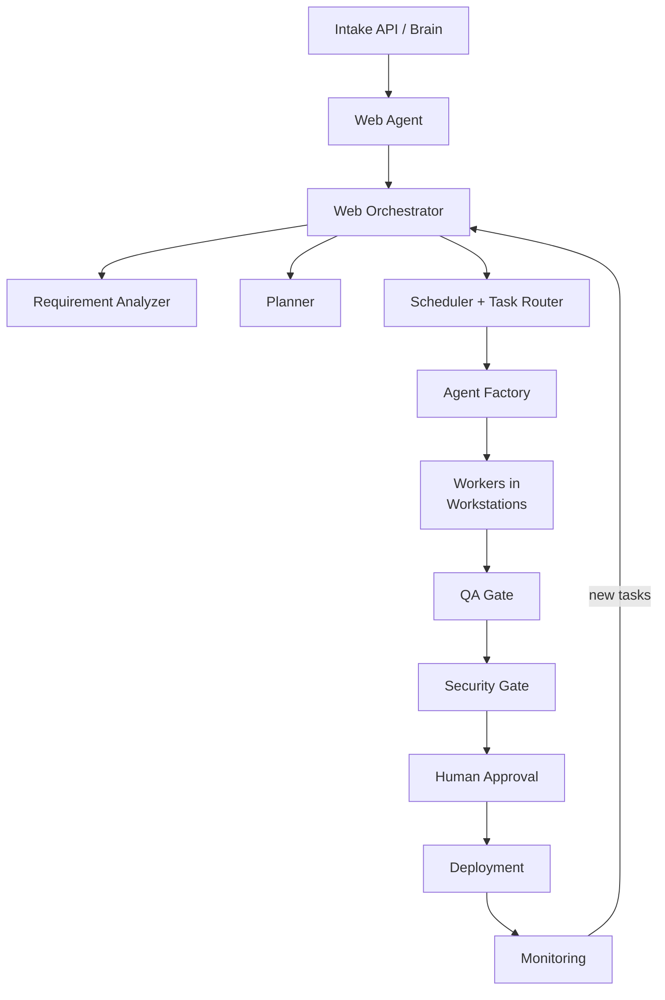
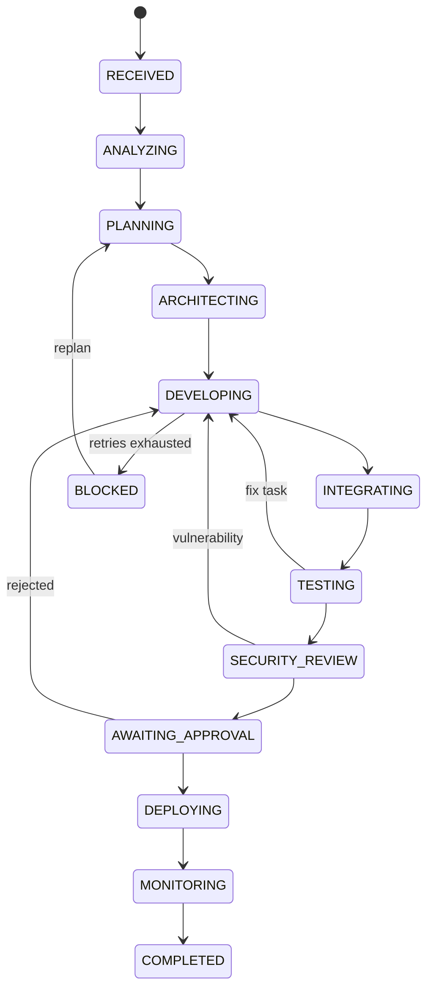

# AlgoHub AI Workforce Factory — Web Development Department: Software Requirements Specification

**2026-09-19 · @Someone**
Version 1.0 · Open-source (MIT) · Built on free and self-hosted components only.

This SRS defines what the Web Development Department must do to turn a web project request
into a planned, built, tested, secured, deployed and monitored application using autonomous AI
agents, with no paid model APIs.

## 1. Introduction

### 1.1 Purpose

This SRS specifies the functional, data, interface and quality requirements of the AlgoHub Web
Development Department ("the Web Department"). It is written for contributors, reviewers and
maintainers of the open-source project, and it is the baseline against which releases are
accepted.

### 1.2 Scope

The Web Department is an autonomous multi-agent software engineering system. It receives a web
project request, converts it into structured requirements and a task plan, assembles a team of
specialized AI agents, runs them in isolated workspaces, and passes the result through QA,
security, human approval, deployment and monitoring.

- **In scope:** web applications (frontend, backend, database, API, authentication, deployment,
  monitoring, maintenance).
- **Out of scope:** the other AlgoHub departments (AI, Mobile, Design, Research, Blog, Medical).
  The factory-level Brain, Project Analyzer and Project Manager are represented in v1 by a simple
  intake interface (see 2.1).
- **Hard constraint:** the system must run at zero software cost, using only open-source
  software, self-hosted models and free-tier services.

### 1.3 Definitions and acronyms

| Term | Meaning |
|---|---|
| Agent / Worker | An LLM-driven process with a role, tools, permissions and memory, created from a Blueprint |
| Blueprint | Versioned YAML definition of a worker role (role, prompt, tools, model, permissions, budget) |
| Agent Factory | Component that instantiates workers from Blueprints and returns them to the pool |
| Workstation | Isolated Docker container + Git repository where a worker acts |
| War Room | Temporary per-project collaboration space holding the active team, tasks and events |
| Web Office | Permanent department environment holding the worker pool, standards and knowledge |
| Gate | Automated or human checkpoint that must pass before work proceeds (QA, security, approval) |
| RPD / RPM | Requests per day / per minute, the rate limits of free LLM API tiers |
| LLM | Large language model |
| MVP | Minimum viable product (Release 1) |

### 1.4 References

- AlgoHub AI Workforce Factory — Web Development Department: Complete Step-by-Step Technical &
  Operational Documentation (source architecture, Steps 1–40)
- ISO/IEC/IEEE 29148:2018, Requirements engineering (structure of this SRS)
- Tool and model references are listed under Sources in section 13

### 1.5 Conventions

- Requirement IDs: **FR-** functional, **NFR-** non-functional, **DR-** data, **IR-** interface.
- Priority: **M** = Must (Release 1–2), **S** = Should (Release 3–4), **C** = Could (Release 5+).
- "Shall" marks a mandatory requirement; "should" marks a recommended one.

## 2. Overall description

### 2.1 Product perspective

The Web Department is one department of the AlgoHub AI Workforce Factory. The Brain decides that
work belongs to Web; the Web Department owns all web-specific execution. In Release 1 the
upstream chain (Human → Project Request → Project Analyzer → Project Manager → Brain) is replaced
by an **Intake API and web form** that emits the same request schema, so the department can later
be plugged into a real Brain without change.

### 2.2 Product functions (summary)

1. Accept and validate web project requests.
2. Convert requests into a structured Web Requirements Specification.
3. Plan milestones and tasks with dependencies.
4. Create project teams of AI workers from Blueprints.
5. Run workers in isolated workstations with scoped tools.
6. Build frontend, backend, database and API code; integrate it.
7. Enforce QA, security, performance and human-approval gates.
8. Deploy with health checks and rollback.
9. Monitor production and turn findings into new tasks.
10. Expose everything through a dashboard and an audit log.

### 2.3 User classes

| User class | Description | Main interactions |
|---|---|---|
| Requester | Person submitting a web project | Submits request, answers clarifications, views progress |
| Approver | Human with release authority (maintainer / CTO role) | Approves or rejects gated actions |
| Operator | Runs and configures the platform | Manages Blueprints, models, limits, secrets |
| Contributor | Open-source developer | Extends agents, tools, Blueprints, docs |
| Brain (system) | Future factory orchestrator | Calls the Intake API, receives status events |

### 2.4 Operating environment

- **Host:** a single Linux, macOS or Windows (WSL2) machine with Docker. Minimum 16 GB RAM;
  recommended 32 GB RAM and a GPU with 8–24 GB VRAM for local models.
- **Models:** local via Ollama, with optional free-tier cloud APIs as fallback.
- **Runtimes:** Python 3.11+, Node.js 20+, PostgreSQL 16+, Redis 7+.
- **Generated apps (v1 golden stack):** Next.js (frontend), FastAPI (backend), PostgreSQL
  (database).

### 2.5 Design and implementation constraints

- **C-1 Zero cost:** no paid LLM API, SaaS or hosting may be required to run the system. Paid
  providers may be supported only as optional plugins.
- **C-2 Open source:** the codebase is released under the MIT license; every dependency must use
  an OSI-approved license compatible with MIT.
- **C-3 Rate limits:** free LLM tiers impose request limits, so the system shall budget, queue and
  fall back between providers.
- **C-4 Model capability:** local models are weaker than frontier models, so tasks shall be small,
  templated and verified by tests rather than trusted.
- **C-5 Data privacy:** some free tiers may use prompts for training; secrets and private client
  code shall never be sent to them.
- **C-6 Single-node first:** Release 1–4 target one machine; horizontal scaling is Release 5+.

### 2.6 Assumptions and dependencies

- Docker is available and the operator can run containers.
- At least one model is reachable: a local Ollama model, or a free API key.
- Free deployment targets (e.g. Vercel, Netlify, Cloudflare Pages, GitHub Actions) keep offering
  usable free tiers; if not, local Docker deployment is the fallback.
- Requests describe typical CRUD-style web apps; highly specialized domains may need human help.

## 3. System architecture

The system is a layered orchestrator: a LangGraph state machine plans and routes work, workers
execute inside isolated workstations, and gates decide whether work moves forward.



Every arrow is recorded as an event in the event store, and the Model Router sits beside all
LLM-using components.

### 3.1 Request lifecycle



`FAILED` is reachable from any state on an unrecoverable error.

### 3.2 Module responsibilities

| Module | Responsibility | Key technology |
|---|---|---|
| Intake API | Validate requests, create project record | FastAPI, Pydantic |
| Web Agent | Accept Web-scope work, track project, report to Brain | Python service |
| Orchestrator | Run the project state machine, checkpoints, retries | LangGraph + PostgreSQL checkpointer |
| Requirement Analyzer | Natural language → Web Requirements Specification (JSON) | LLM + JSON schema validation |
| Planner | Specification → task DAG with dependencies | LLM + template task library |
| Scheduler / Task Router | Run ready tasks in parallel, assign to best worker | Redis queue, topological sort |
| Blueprint Registry | Store and version worker definitions | YAML files in Git |
| Agent Factory | Create, assign, recycle workers | Python, OpenHands Agent SDK |
| Workstation Manager | Provision isolated containers per project | Docker SDK |
| Model Router | Route LLM calls, fall back on rate limits, cache | LiteLLM, Ollama |
| Knowledge Service | Standards, project context, agent memory | PostgreSQL + pgvector |
| Event Bus / Audit | Structured events, audit trail | Redis Streams + PostgreSQL |
| Gates | QA, security, performance, approval | pytest, Vitest, Playwright, Semgrep, Gitleaks, Trivy |
| Deployer | Build, deploy, health-check, rollback | GitHub Actions, Docker |
| Monitor | Health, logs, errors, alerts → tasks | Uptime Kuma, Sentry (free), Langfuse |
| Dashboard | Operational view and approvals | Next.js |

## 4. Functional requirements — intake, orchestration and planning

### 4.1 Intake and Web Agent entry point

| ID | Requirement | Priority |
|---|---|---|
| FR-001 | The system shall accept a project request via REST API and web form containing title, description, optional constraints and requester ID. | M |
| FR-002 | The Web Agent shall classify whether a request is Web scope and reject or route non-Web requests with a reason. | M |
| FR-003 | The Web Agent shall create a project record in state RECEIVED and emit `PROJECT_RECEIVED`. | M |
| FR-004 | The Web Agent shall report project status changes to the Brain (or intake caller) via webhook and event stream. | S |
| FR-005 | The system shall allow the requester to attach reference files (text, images, existing specs). | S |

### 4.2 Orchestration

| ID | Requirement | Priority |
|---|---|---|
| FR-010 | The Orchestrator shall drive each project through the states in section 7.2 and persist every transition. | M |
| FR-011 | The Orchestrator shall checkpoint state so a project resumes after a crash or restart without repeating completed tasks. | M |
| FR-012 | The Orchestrator shall enforce a maximum retry count per task (default 3) and then move the task to BLOCKED and escalate. | M |
| FR-013 | The Orchestrator shall trigger review checkpoints (QA, security, approval) defined by project policy. | M |
| FR-014 | The Orchestrator shall support pausing, resuming and cancelling a project by an Operator. | S |

### 4.3 Requirement analysis

| ID | Requirement | Priority |
|---|---|---|
| FR-020 | The Requirement Analyzer shall convert the request into a Web Requirements Specification (WRS) JSON document validated against a published JSON Schema. | M |
| FR-021 | The WRS shall contain: project type, domain, roles, features, pages and user journeys, data entities, API needs, integrations, security level, non-functional expectations, deployment target and acceptance criteria. | M |
| FR-022 | When required fields are ambiguous, the Analyzer shall generate up to 5 clarification questions and hold the project in ANALYZING until answered or a timeout applies defaults. | S |
| FR-023 | Each feature shall carry at least one testable acceptance criterion. | M |
| FR-024 | The WRS shall be versioned; any change creates a new version and records who or what changed it. | S |

Example WRS fragment:

```json
{
  "project_type": "web_application",
  "domain": "ecommerce",
  "roles": ["customer", "admin"],
  "features": [
    {"id": "F-01", "name": "authentication", "acceptance": ["User can register, log in and log out"]},
    {"id": "F-02", "name": "cart", "acceptance": ["Cart total updates when quantity changes"]}
  ],
  "entities": ["User", "Product", "Order"],
  "security_level": "standard",
  "stack": "golden-v1"
}
```

### 4.4 Planning, architecture and scheduling

| ID | Requirement | Priority |
|---|---|---|
| FR-030 | The Planner shall convert the WRS into milestones and tasks, each with ID, description, inputs, outputs, dependencies, worker role and acceptance checks. | M |
| FR-031 | The Planner shall build tasks from a reusable task template library for the golden stack before generating free-form tasks. | M |
| FR-032 | The plan shall form a directed acyclic graph; the system shall reject plans with cycles or missing dependencies. | M |
| FR-033 | The Architect worker shall produce an architecture record: components, API contracts (OpenAPI), database schema draft and decision log. | M |
| FR-034 | The Scheduler shall run all tasks whose dependencies are complete in parallel, up to a configurable concurrency limit (default 2 on one machine). | M |
| FR-035 | The Task Router shall assign each task to an available worker whose Blueprint role and skills match the task. | M |
| FR-036 | The Scheduler shall respect LLM rate-limit budgets and delay tasks rather than fail when budgets are exhausted. | M |
| FR-037 | Tasks waiting on dependencies shall be in state DEPENDENCY_WAITING and emit that event. | S |
| FR-038 | A task shall be sized so that a worker changes no more than about 5 files or 300 lines; larger tasks shall be split. | S |

## 5. Functional requirements — workforce

### 5.1 Blueprints

| ID | Requirement | Priority |
|---|---|---|
| FR-040 | Each worker role shall be defined by a Blueprint YAML file with: role, responsibilities, skills, system prompt, tools, model preference list, memory scope, permissions, workflow, communication events, evaluation checks, autonomy level and rate-limit budget. | M |
| FR-041 | Blueprints shall be validated against a schema at load time; invalid Blueprints shall not be instantiated. | M |
| FR-042 | Blueprints shall be versioned in Git; each worker records the Blueprint version it was created from. | M |
| FR-043 | Contributors shall be able to add a new worker role by adding a Blueprint and optional tool plugins, without changing the Orchestrator. | S |

Example Blueprint:

```yaml
id: frontend_developer
version: 1.0.0
role: Frontend Developer
responsibilities: [pages, components, forms, api_consumption, responsive_ui]
models: [ollama/qwen3-coder, groq/llama-3.3-70b, gemini/flash]
tools: [file_read, file_write, terminal, browser, git, test_runner]
permissions: {code_write: true, db: limited, deploy: false}
autonomy: supervised
budget: {max_llm_calls_per_task: 40, max_retries: 3}
evaluation: [lint_pass, unit_tests_pass, screenshot_attached]
```

### 5.2 Agent Factory and worker pool

| ID | Requirement | Priority |
|---|---|---|
| FR-050 | The Agent Factory shall create workers only for roles the current plan needs, with IDs like `WEB-FE-001`. | M |
| FR-051 | Workers shall follow the lifecycle Created → Provisioned → Available → Assigned → Working → Review → Completed → Available. | M |
| FR-052 | Idle workers shall be returned to the pool and their workstation released at project end. | S |
| FR-053 | A worker in Working longer than its timeout (default 30 min per task) shall move to a diagnosis path. | M |
| FR-054 | The pool shall scale the number of workers per role based on queued tasks and host capacity limits. | C |

### 5.3 Workstations and project isolation

| ID | Requirement | Priority |
|---|---|---|
| FR-060 | Each project shall get its own Docker network, container(s), Git repository and secrets scope. | M |
| FR-061 | A workstation shall provide: file system, terminal, language runtimes, package manager, Git, test runners, headless browser, API client and log access. | M |
| FR-062 | Workers shall act only through the tool layer; every tool call is checked against the worker's permissions and logged. | M |
| FR-063 | Terminal commands shall pass an allow/deny list; destructive commands (e.g. `rm -rf /`, dropping databases) require approval. | M |
| FR-064 | Workstations shall have CPU, memory and time limits and no access to other projects' files or the host file system. | M |
| FR-065 | Workers shall observe via "eyes" (source, DOM, screenshots, terminal output, logs, test results) and act via "hands" (file edits, commands, Git, browser actions, authorized APIs/DB). | M |

### 5.4 Knowledge and memory

| ID | Requirement | Priority |
|---|---|---|
| FR-070 | The system shall hold four knowledge layers: Global (policies, SOPs), Web (frameworks, patterns, standards), Project (WRS, architecture, contracts, schema) and Agent memory (past fixes, known failures). | M |
| FR-071 | Project knowledge shall be retrievable by workers through semantic search (pgvector, local embeddings). | S |
| FR-072 | Successful fixes and recurring failures shall be stored as memory entries and retrieved for similar future tasks. | S |
| FR-073 | All knowledge entries shall be versioned and traceable to their source. | S |

### 5.5 Team formation and development workers

| ID | Requirement | Priority |
|---|---|---|
| FR-080 | The system shall form a project team from required skills and open a War Room listing members, tasks and events. | M |
| FR-081 | Workers shall communicate through structured events and task records, not free-form chat. | M |
| FR-082 | **Frontend worker** shall create pages and components, forms with validation, responsive layouts, API calls with loading/error/empty states, and attach screenshots as evidence. | M |
| FR-083 | **Backend worker** shall implement services, endpoints, validation, authentication, server-side authorization, consistent errors and unit/integration tests. | M |
| FR-084 | **Database worker** shall design schema, relationships, constraints, indexes and migrations, and shall not run destructive migrations without approval. | M |
| FR-085 | **API/Integration worker** shall own OpenAPI contracts, connect frontend to backend, integrate external services with safe retries, and run end-to-end tests. | M |
| FR-086 | **Maintenance worker** shall handle bug tasks from monitoring and feedback. | S |
| FR-087 | Generated applications shall keep secrets out of source control and separate dev, staging and production configuration. | M |

## 6. Functional requirements — quality, release and operations

### 6.1 QA and failure recovery

| ID | Requirement | Priority |
|---|---|---|
| FR-100 | The QA worker shall run lint, type checks, unit, integration, API, end-to-end (Playwright) and regression tests for every integration build. | M |
| FR-101 | Each WRS acceptance criterion shall map to at least one automated test; the QA result shall report coverage of criteria. | M |
| FR-102 | On test failure the system shall analyse output, identify the responsible task and worker, create a `FIX_REQUIRED` task with the failing output attached, and retest after the fix. | M |
| FR-103 | After the retry limit, the system shall escalate: replan the task, switch to a stronger model, or request human review. | M |
| FR-104 | Generated code shall never be marked complete without passing its task's evaluation checks. | M |

### 6.2 Security gate

| ID | Requirement | Priority |
|---|---|---|
| FR-110 | The Security worker shall run static analysis (Semgrep), secret scanning (Gitleaks), dependency audit (npm audit / pip-audit) and container scanning (Trivy) before approval. | M |
| FR-111 | The Security worker shall review authentication, authorization, input validation, access control, API protection and data isolation against a checklist. | M |
| FR-112 | Any finding of severity High or Critical shall block release and create a fix task. | M |
| FR-113 | Security exceptions shall require Approver sign-off and be recorded in the audit log. | S |

### 6.3 Performance validation

| ID | Requirement | Priority |
|---|---|---|
| FR-120 | The system shall measure API response times and page load metrics (Lighthouse) against thresholds set in the WRS. | S |
| FR-121 | Load tests (k6 or Locust) shall run only when the WRS sets a load requirement. | C |

### 6.4 Human approval and governance

| ID | Requirement | Priority |
|---|---|---|
| FR-130 | The following actions shall require human approval: production deployment, destructive database changes, credential or secret changes, major architecture changes, infrastructure changes and security exceptions. | M |
| FR-131 | Approval requests shall show a summary, diff, test and security results, and allow Approve or Reject with a comment. | M |
| FR-132 | A rejection shall return the project to DEVELOPING with the comment attached as a task input. | M |

### 6.5 Deployment

| ID | Requirement | Priority |
|---|---|---|
| FR-140 | The DevOps worker shall generate build and CI configuration (Dockerfile, GitHub Actions workflow). | M |
| FR-141 | The system shall deploy approved builds to a configured target: local Docker (default) or a free hosting provider. | M |
| FR-142 | After deployment the system shall run health checks and smoke tests, and record deployment metadata (version, commit, time, approver). | M |
| FR-143 | The system shall roll back to the last healthy version automatically when health checks fail. | M |

### 6.6 Monitoring and feedback

| ID | Requirement | Priority |
|---|---|---|
| FR-150 | The system shall monitor availability, error rates, API failures, logs, performance and resource usage of deployed apps. | S |
| FR-151 | Detected issues shall create analysed tasks automatically, linked to the triggering alert. | S |
| FR-152 | Requesters shall be able to submit feedback or bug reports that enter the same task pipeline. | S |
| FR-153 | The department shall trace every LLM call (prompt, model, tokens, latency, result) for evaluation. | S |

### 6.7 Dashboard

| ID | Requirement | Priority |
|---|---|---|
| FR-160 | The dashboard shall show totals of agents (available, working, blocked), active projects, pending and failed tasks, deployments and pending approvals. | M |
| FR-161 | The dashboard shall provide views for Projects, Agents, Tasks, Workstations, Knowledge, Security, Deployments and Monitoring. | S |
| FR-162 | Each project view shall show its task graph, live event feed, War Room members and artifacts. | S |
| FR-163 | Blocked tasks, failed tests and pending approvals shall never be hidden or collapsed by default. | M |

## 7. Data and state models

### 7.1 Core entities

| Entity | Key fields |
|---|---|
| Project | id, title, requester_id, state, wrs_version, stack, created_at, updated_at |
| RequirementSpec | id, project_id, version, json, created_by |
| Task | id (WEB-###), project_id, title, role, state, depends_on[], inputs, outputs, acceptance_checks[], retries, assigned_agent_id |
| Blueprint | id, version, yaml, checksum |
| Agent | id (WEB-FE-001), blueprint_id, blueprint_version, state, project_id, workstation_id |
| Workstation | id, project_id, container_id, repo_path, limits, status |
| Event | id, type, project_id, task_id, agent_id, payload, timestamp |
| Approval | id, project_id, action_type, summary, status, approver_id, comment, decided_at |
| Deployment | id, project_id, version, commit_sha, target, status, health, approver_id, deployed_at |
| KnowledgeEntry | id, layer, project_id?, content, embedding, source, version |
| LLMCall | id, agent_id, task_id, provider, model, tokens_in, tokens_out, latency_ms, cached, status |

| ID | Requirement | Priority |
|---|---|---|
| DR-001 | All entities shall be stored in PostgreSQL with migrations managed in the repository. | M |
| DR-002 | Project, task and agent states shall be tracked separately. | M |
| DR-003 | Events and approvals shall be append-only. | M |
| DR-004 | Each record belonging to a project shall carry project_id for isolation and audit. | M |

### 7.2 State sets

| Object | States |
|---|---|
| Project | RECEIVED, ANALYZING, PLANNING, ARCHITECTING, DEVELOPING, INTEGRATING, TESTING, SECURITY_REVIEW, AWAITING_APPROVAL, DEPLOYING, MONITORING, COMPLETED, FAILED, BLOCKED |
| Task | CREATED, DEPENDENCY_WAITING, READY, ASSIGNED, IN_PROGRESS, REVIEW, FIX_REQUIRED, COMPLETED, BLOCKED, CANCELLED |
| Agent | CREATED, PROVISIONED, AVAILABLE, ASSIGNED, WORKING, REVIEW, BLOCKED, RETIRED |

### 7.3 Event schema

Event types: `TASK_CREATED`, `TASK_ASSIGNED`, `TASK_STARTED`, `DEPENDENCY_WAITING`,
`TASK_COMPLETED`, `REVIEW_REQUIRED`, `TEST_FAILED`, `FIX_REQUIRED`, `SECURITY_BLOCKED`,
`APPROVAL_REQUESTED`, `APPROVED`, `REJECTED`, `DEPLOYED`, `ROLLED_BACK`, `ALERT_RAISED`.

```json
{
  "event_id": "evt_01J...",
  "event": "TASK_COMPLETED",
  "project_id": "project_001",
  "task_id": "WEB-007",
  "agent_id": "WEB-FE-001",
  "status": "completed",
  "requires_review": true,
  "payload": {"files_changed": 4, "tests_passed": 18},
  "timestamp": "2026-09-19T17:00:00Z"
}
```

## 8. External interface requirements

### 8.1 User interface

| ID | Requirement | Priority |
|---|---|---|
| IR-001 | The dashboard shall be a responsive web app usable at 360 px width and above, in light and dark themes. | M |
| IR-002 | The request form shall guide the requester through description, features, roles and constraints, and show clarification questions inline. | M |
| IR-003 | Project progress shall update live (WebSocket or server-sent events) without page reload. | S |
| IR-004 | The approval screen shall show diff, test report, security report and screenshots on one page. | M |

### 8.2 REST API (v1)

| Method | Endpoint | Purpose |
|---|---|---|
| POST | `/api/v1/projects` | Submit a project request |
| GET | `/api/v1/projects/{id}` | Project state, WRS, plan summary |
| POST | `/api/v1/projects/{id}/clarifications` | Answer analyzer questions |
| GET | `/api/v1/projects/{id}/tasks` | Task graph and states |
| GET | `/api/v1/projects/{id}/events` | Event stream (SSE) |
| POST | `/api/v1/approvals/{id}` | Approve or reject |
| POST | `/api/v1/projects/{id}/feedback` | Submit feedback or bug |
| GET | `/api/v1/agents` | Worker pool status |
| GET/PUT | `/api/v1/blueprints/{id}` | Read or update a Blueprint (Operator) |

**IR-010 (M):** The API shall be documented with OpenAPI 3 and protected by token authentication
with role-based access (Requester, Approver, Operator).

### 8.3 LLM provider interface

| ID | Requirement | Priority |
|---|---|---|
| IR-020 | All LLM calls shall go through a single Model Router exposing an OpenAI-compatible interface (LiteLLM). | M |
| IR-021 | The router shall support local Ollama models and free-tier providers (e.g. Groq, Cerebras, Google AI Studio, OpenRouter free models, GitHub Models, Mistral). | M |
| IR-022 | The router shall fall back in configured order on rate-limit, timeout or error responses. | M |
| IR-023 | The router shall cache responses by prompt hash and track per-provider daily usage. | S |
| IR-024 | Each provider shall be tagged `private` (local) or `shared` (may train on prompts); tasks marked confidential shall use `private` providers only. | M |

### 8.4 Tool and system interfaces

| Interface | Used for |
|---|---|
| Docker Engine API | Create, limit and destroy workstations |
| Git (local + GitHub) | Version control per project, PR-based review |
| OpenHands Agent SDK | Worker execution loop, sandboxed tool use |
| Playwright | Browser automation, screenshots, E2E tests |
| MCP (Model Context Protocol) | Optional plug-in tools for workers |
| GitHub Actions / hosting CLIs | Build and deployment |
| Webhooks | Status notifications to Brain or chat tools |

## 9. Non-functional requirements

| ID | Category | Requirement | Priority |
|---|---|---|---|
| NFR-001 | Cost | Running the full system shall require $0 in software, API or hosting fees. | M |
| NFR-002 | Cost | The system shall operate within free-tier limits by budgeting calls per provider per day and preferring local models for high-volume loops. | M |
| NFR-003 | Performance | For the reference project (todo app with login), the MVP shall reach a passing build in under 2 hours on the recommended hardware. | S |
| NFR-004 | Performance | Dashboard pages shall load in under 2 s and event updates shall appear within 2 s. | S |
| NFR-005 | Reliability | No completed task shall be lost on crash; projects resume from the last checkpoint. | M |
| NFR-006 | Reliability | The system shall never enter unbounded retry loops (bounded by FR-012 and per-task LLM call budgets). | M |
| NFR-007 | Security | Workers shall run with least privilege inside containers with no host mounts except their project workspace. | M |
| NFR-008 | Security | Secrets shall be stored encrypted (e.g. `.env` outside Git, SOPS or Docker secrets) and never sent to `shared` LLM providers. | M |
| NFR-009 | Security | All important actions shall produce auditable, append-only events. | M |
| NFR-010 | Security | Production actions shall be more restricted than development actions. | M |
| NFR-011 | Quality | Generated apps shall pass lint and tests and have zero High/Critical security findings before release. | M |
| NFR-012 | Observability | Every LLM call, tool call and state change shall be traceable per project (Langfuse + event store). | S |
| NFR-013 | Maintainability | The platform's own code shall keep at least 70% unit test coverage and pass CI on every pull request. | S |
| NFR-014 | Extensibility | New worker roles, tools and model providers shall be addable through Blueprints and plugins without core changes. | S |
| NFR-015 | Portability | The platform shall start with a single `docker compose up` command. | M |
| NFR-016 | Open source | Code under MIT; contribution guide, code of conduct, issue templates and architecture docs in the repository. | M |
| NFR-017 | Usability | A new contributor shall be able to run the reference project within 30 minutes by following the README. | S |

## 10. Permissions and governance

Permissions are enforced by the tool layer on every call, not by prompts. Defaults below apply to
development; production access is narrower.

| Worker | Read code | Write code | Database | Deploy | Security review |
|---|---|---|---|---|---|
| Architect | Yes | Docs and scaffolding | Schema draft | No | Limited |
| Frontend | Yes | Yes | Limited | No | Limited |
| Backend | Yes | Yes | Yes (dev) | No | Limited |
| Database | Yes | Yes | Yes (dev), migrations need approval in prod | No | Limited |
| API / Integration | Yes | Yes | Limited | No | Limited |
| QA | Yes | Tests only | Test DB only | No | Yes |
| Security | Yes | Review / fix suggestions | Limited | No | Yes |
| DevOps | Yes | CI and infra files | Infrastructure | Controlled (after approval) | Yes |
| Maintenance | Yes | Yes | Limited | No | Limited |

### 10.1 Operational rules

1. No agent may bypass the orchestrator or the permission layer.
2. Generated code is never assumed correct; it must pass its evaluation checks.
3. Every production-bound project passes QA and security gates.
4. Every agent has a defined role and permission boundary from its Blueprint.
5. Every project uses an isolated workspace.
6. Every important action produces an auditable event.
7. Repeated failures trigger diagnosis and escalation, not infinite retries.
8. Knowledge and project context are versioned and traceable.
9. Workers are scaled to actual demand.

## 11. Free and open-source technology stack

Every component below is open source or has a no-card free tier; paid options are never required.
Free-tier limits change often, so check them before relying on them.

| Layer | Choice | License / cost |
|---|---|---|
| Orchestration | LangGraph | MIT |
| Worker runtime | OpenHands Agent SDK | MIT |
| Role design reference | MetaGPT, ChatDev | MIT, Apache-2.0 |
| Model router | LiteLLM | MIT (core) |
| Local models | Ollama with Qwen3 8B (8 GB VRAM), Devstral Small 24B (~16 GB) or Qwen 3.6 27B (~22 GB) | Free, local |
| Free API fallback | Groq, Cerebras, Google AI Studio, OpenRouter free models, GitHub Models, Mistral | Free tiers, rate-limited |
| Backend | FastAPI, Pydantic, SQLAlchemy, Alembic | MIT / BSD |
| Data | PostgreSQL + pgvector, Redis (Streams, queue) | Open source |
| Embeddings | `nomic-embed-text` via Ollama | Free, local |
| Isolation | Docker, Docker Compose | Free |
| Testing | pytest, Vitest, Playwright, Lighthouse, k6 | Open source |
| Security | Semgrep CE, Gitleaks, Trivy, npm audit, pip-audit | Open source |
| CI/CD | GitHub Actions (free for public repos) | Free |
| Hosting (generated apps) | Local Docker; Vercel / Netlify / Cloudflare Pages free tiers | Free tiers |
| Monitoring | Uptime Kuma, Sentry free tier, Langfuse (self-hosted), Grafana + Prometheus | Open source / free |
| Dashboard | Next.js, Tailwind CSS, shadcn/ui | MIT |

### 11.1 Model routing policy

| Task type | Preferred model | Reason |
|---|---|---|
| Requirement analysis, planning, architecture | Strongest free API model available | Called rarely; quality matters most |
| Coding and fix loops | Local Ollama model | High volume; no rate limit; private |
| Review and security reasoning | Free API model, then local | Second opinion from a different model |
| Embeddings | Local `nomic-embed-text` | Free and private |

### 11.2 Golden stack for generated apps (v1)

Next.js + TypeScript + Tailwind (frontend), FastAPI + SQLAlchemy (backend), PostgreSQL
(database), pytest + Vitest + Playwright (tests), Docker (packaging). Other stacks are Release 5+
via additional templates.

## 12. Release phases and acceptance criteria

Each release is accepted only when its exit criteria pass on a clean machine.

| Release | Scope | Requirements covered | Exit criteria |
|---|---|---|---|
| R1 — Core loop (MVP) | Intake, Analyzer, Planner, one generalist coder worker, workstation, test-fix loop, Model Router | FR-001–003, 010–012, 020–021, 023, 030–032, 060–065, 100–104; IR-020–022 | "Todo app with login" request produces a running app with all generated tests passing, with no human code edits |
| R2 — Workforce | Blueprints, Agent Factory, Architect/Frontend/Backend/Database/API workers, parallel scheduler, events, War Room | FR-033–038, 040–053, 080–085; DR-001–004 | Two independent tasks run in parallel; e-commerce reference request completes |
| R3 — Gates | Security gate, human approval, dashboard v1 | FR-110–113, 130–132, 160, 163; IR-001, 004 | A seeded vulnerability blocks release; approval flow works end to end |
| R4 — Release and ops | Deployment, rollback, monitoring, feedback loop | FR-140–143, 150–153 | Deploy to local Docker and one free host; failed health check triggers rollback; an alert creates a task |
| R5 — Scale and learn | Knowledge memory, worker pool scaling, performance tests, more stacks, Brain integration | FR-054, 070–073, 120–121 | Memory measurably reduces fix retries on a repeated project type |

### 12.1 Definition of Done (whole department)

- [ ] A human can submit a web project request.
- [ ] The request reaches the Web Agent through the Brain or Intake API.
- [ ] Requirements are converted into structured tasks.
- [ ] The system creates or assigns appropriate Web workers.
- [ ] Workers receive isolated workstations and required knowledge.
- [ ] Workers can inspect and modify authorized project artifacts.
- [ ] Frontend, backend, database and API work are coordinated.
- [ ] Dependencies and parallel tasks are handled correctly.
- [ ] QA detects failures and creates fix tasks.
- [ ] Security can block unsafe releases.
- [ ] Production deployment is controlled and auditable.
- [ ] Monitoring detects operational problems.
- [ ] Feedback triggers new development work.
- [ ] Full project state is visible on the dashboard.
- [ ] All of the above runs at $0 cost with open-source components.

### 12.2 Reference test projects

| Project | Purpose |
|---|---|
| Todo app with login | R1 smoke test: auth, CRUD, tests |
| Clothing e-commerce (products, cart, checkout, admin) | R2–R3: multi-role, parallel work, security gate |
| University Management System | R4–R5: large end-to-end run from the source architecture document |

## 13. Risks, open questions and sources

### 13.1 Risks

| Risk | Impact | Mitigation |
|---|---|---|
| Local models produce low-quality or broken code | High | Golden-stack templates, small tasks, test-driven verification, escalation to stronger free model |
| Free API tiers reduce limits or disappear | High | Local-first routing, multiple providers, response cache |
| Prompts sent to free tiers used for training | Medium | `private` / `shared` provider tags; confidential work stays local (IR-024) |
| Agents execute harmful commands | High | Container isolation, command allow-list, approval for destructive actions |
| Supply-chain attack via dependencies or cloned tools | High | Pin versions, dependency audit, only use maintained repos (gpt-pilot's repo contained hidden malicious code Aug 2025–Jun 2026) |
| Hardware too weak for useful local models | Medium | Qwen3 8B minimum; offload planning to free APIs; free GPU notebooks for experiments |
| Scope too large for a solo maintainer | High | Strict release order (section 12); accept community contributions per Blueprint |

### 13.2 Open questions

- [ ] Which minimum hardware will the reference setup target (RAM, GPU VRAM)?
- [ ] Will the Brain, Project Analyzer and Project Manager be specified in a separate SRS, and
      when?
- [ ] Which free hosting target is the default for R4?
- [ ] Who holds the Approver role for public demos?
- [ ] Project name and repository location for the open-source release.

### 13.3 Sources

- AlgoHub AI Workforce Factory — Web Development Department documentation (source architecture)
- OpenHands GitHub · OpenHands local LLM docs
- MetaGPT GitHub · ChatDev GitHub
- Free LLM API in 2026: 13 Options Ranked and Compared (OpenRouter)
- Best Local Coding LLMs 2026 (PromptQuorum)
- gpt-pilot repository security notice
- ISO/IEC/IEEE 29148:2018 Systems and software engineering — Requirements engineering
